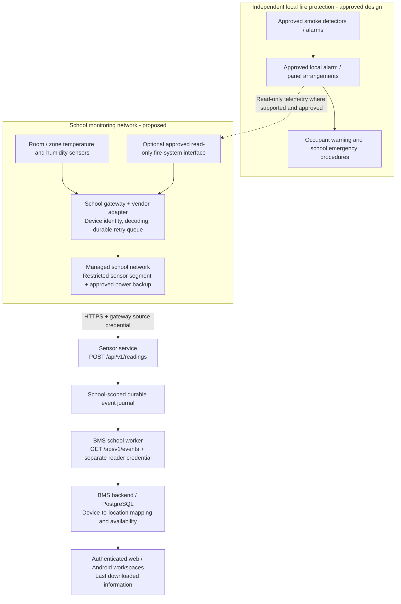

# School dormitory sensor architecture

**Status:** Proposed deployment design, not an installed or certified system.
**Scope:** Smoke detection, room temperature and relative humidity.
**Audience:** School leadership, facilities staff, installers and BMS developers.

## 1. What the school is setting up

Each monitored room or area has identifiable sensors. Their observations travel
through a school gateway/adapter to the Wallinde sensor service. The BMS backend
associates each device with its actual dormitory location, and staff review the
latest downloaded information in their authorised workspace.

There are **two separate systems**:

| System | Responsibility | Dependency on BMS |
|---|---|---|
| Approved local fire protection | Detect fire and warn occupants through the school's approved alarm and evacuation arrangements | None |
| BMS monitoring | Record supplementary observations, show device availability and support inspection/follow-up work | Requires the sensor data path |

The BMS gateway must not be required for local smoke detection or occupant
notification. BMS must not silence, reset or control fire-alarm equipment.
Connect an existing fire panel only through a manufacturer-approved, read-only
interface installed by a qualified fire-system professional.

USFA campus guidance highlights functioning smoke alarms, fire-alarm systems,
escape routes and sprinklers [1]. It is background guidance, **not a substitute
for the school's applicable building/fire rules**. Country, occupancy
classification, building plans and the responsible local authority must be
confirmed before selecting or installing life-safety equipment. Do not treat
ordinary IoT smoke sensors or temperature thresholds as an approved fire system.

## 2. Architecture diagram



The read-only panel connection is optional and **not implemented** in the current
application. If a panel exposes only a zone-level alarm, map that observation to
the zone; do not invent room-level precision. Do not connect individual panel
detectors to an IoT gateway unless the manufacturer-approved design permits it.

## 3. Physical setup in each dormitory

Survey the dormitory first: rooms, floors, corridors, stairs, common areas,
electrical/service rooms, existing alarm zones, network routes and power.

| Area | Proposed monitoring arrangement | Installation constraint |
|---|---|---|
| Sleeping rooms | Temperature/humidity monitoring for each independently monitored room or environmental zone; smoke protection according to the approved fire design | Smoke device type, count, position, interconnection and coverage are determined by the qualified designer, local requirements and manufacturer |
| Corridors, stairs and common areas | Environmental monitoring where these are distinct zones; approved fire coverage as required | A corridor reading must not be presented as every bedroom's condition |
| Electrical/service rooms | Assess separately with the fire designer; add environmental telemetry only where suitable | Do not assume the same sensor type is appropriate for every hazard |
| Secure communications location | Gateway/adapter, network equipment and approved power backup | Accessible to authorised maintainers, not students; not obstructing an escape route |

For temperature/humidity, choose a representative ambient-air position following
the selected product's instructions. Avoid mounting that measures a heater,
sunlit surface, direct ventilation jet or the gateway's own heat instead of room
air. Keep sensing vents unobstructed and use an enclosure appropriate to the
environment. Sensirion's design guidance explains the effects of airflow,
enclosure design and nearby heat on these measurements [2].

**No universal detector spacing, mounting height or device quantity is prescribed
here.** These require the actual plans and selected equipment.

### Illustrative inventory, not a fire coverage plan

For a dormitory with eight separately monitored bedrooms and one distinct common
area, a starting environmental inventory could be eight combined
temperature/humidity devices plus one common-area device. Validate whether room
size, partitions or airflow require additional measurement points.

Smoke equipment quantities come from the approved fire design, not this example.
One school gateway may serve several dormitories, or several gateways may be
needed. Decide from measured network coverage, device capacity and acceptable
failure domains, not a fixed "one gateway per dormitory" rule.

## 4. Hardware and school-network selection

Do not purchase a specific model until the following are verified.

| Component | Selection/acceptance requirement |
|---|---|
| Fire equipment/interface | Appropriate local approvals and occupancy suitability; independent local operation; documented alarm, clear and fault semantics; approved telemetry interface |
| Temperature/humidity devices | Stated accuracy and operating range, stable identity, documented reporting behaviour, maintainable power supply and supported local integration |
| Gateway/adapter | Supported vendor protocol, persistent queue, authenticated uplink, clock management, recoverable configuration and observable faults |
| School network | Measured coverage at actual mounting locations, restricted access, sufficient capacity and an agreed outage plan |
| Power/backup | Documented loads, required autonomy and replacement/maintenance procedure, selected by the responsible installer |

**Provisional network approach:** Use the managed school LAN and wired gateway
backhaul where available. A dedicated sensor network segment should permit only
the required device-to-adapter traffic and adapter-to-ingress HTTPS connections.
Keep students' Wi-Fi separate from sensor administration.

Choose the device link after a site survey and vendor evaluation: wired devices,
supported Wi-Fi or a supported low-power radio system. A radio choice such as
LoRaWAN introduces its own network-server and decoder components; these are not
provided by BMS. Do not mix protocols without the necessary adapters.

Design loss-of-power and loss-of-network behaviour explicitly. Size monitoring
backup power from actual loads and agreed outage duration. Backup for the fire
system belongs to the approved fire-system design, not the BMS network design.

## 5. Naming, registration and location mapping

Maintain an installation register with:

| Field | Illustrative value |
|---|---|
| School code | `SCHOOL-A` |
| BMS dormitory / zone / location | Cedar House / Ground floor / Room 01 |
| Gateway ID | `cedar-gw-01` |
| External device ID | `cedar-room01-th-01` |
| Purpose | Room temperature and relative humidity |
| Asset details | Manufacturer, model, serial number and firmware |
| Installation/maintenance | Position, commissioning date, responsible person, battery/service schedule |
| Data policy | Reporting interval, freshness timeout and available measurements |

The gateway ID identifies the credentialed data source; it need not correspond
one-to-one to a physical radio gateway. For a panel, each documented detector or
zone may be a logical external device beneath the panel adapter's gateway ID.

Provision **two distinct credential types** in the sensor service:

1. A gateway source credential with the school code, gateway ID, allowed device
   IDs and `mode`. Use `test` for test-only sources; `hardware` is a source label,
   not certification or proof of a correct installation.
2. A school reader credential used only by that school's BMS worker.

In BMS, an administrator registers a **SERVICE** sensor using the matching
`gatewayId`, `externalDeviceId`, location and `staleAfterSeconds`. Register each
device in both places: source allowlisting alone does not map it into BMS.
Unmapped events do not create a usable location record automatically.

School identity is derived from the source credential, not accepted as an
arbitrary school field in the device observation. Keep credentials in protected
configuration, not in frontend code, device labels or this register.

## 6. Data flow and event meaning

The vendor adapter must validate the device identity, decode its documented
payload and submit the sensor service's v1 format. It must preserve the
observation time, measurement units and event identity.

Illustrative environmental observation:

```json
{
  "schemaVersion": 1,
  "eventId": "82538c39-135c-4b62-83d6-afc4ce02af6a",
  "deviceId": "cedar-room01-th-01",
  "observedAt": "2026-11-25T10:00:00Z",
  "health": "healthy",
  "measurements": {
    "temperatureC": 24.2,
    "humidityPercent": 52.0,
    "batteryPercent": 86.0
  }
}
```

Send it to `POST /api/v1/readings` with the gateway source bearer credential over
the approved HTTPS ingress. The timestamp above is an example, not a value to
reuse; generate a new UUID per new observation.

For supported smoke telemetry, use a separate mapped device and the documented
`smokeAlarm` boolean. Do not send `smokeAlarm: false` from an unrelated
temperature/humidity device.

| Observation | Required interpretation |
|---|---|
| `smokeAlarm: true` | The source explicitly reports an alarm; retain it independently of device availability |
| `smokeAlarm: false` | A later explicit source observation clears that alarm; this does not authorise re-entry or close a finding |
| Missing `smokeAlarm` | No update to the stored smoke state; never infer a clear |
| `health: healthy` | Fresh source-reported health, not a guarantee that the building is safe |
| `health: fault/offline/unknown` or stale data | Monitoring is unavailable/degraded; never present the last normal observation as current |
| Device self-test | Keep separate from real alarm semantics using a documented adapter/test procedure |
| Temperature/humidity | Environmental measurements, not fire-detection thresholds |

The current v1 payload has no dedicated self-test event field. Do not invent an
extra field or silently turn a manufacturer's test event into a real alarm.
Use isolated test sources where appropriate; richer test metadata requires a
deliberate contract change before production integration.

## 7. Reporting, outages and follow-up

Agree a reporting/heartbeat policy **per device type**. Battery-powered devices
may not provide the same reporting cadence as mains-powered devices. Confirm
the vendor behaviour before setting a freshness timeout.

For planning only, a device supporting a genuine 60-second heartbeat might use a
180-second BMS freshness timeout after load and failure testing. This is not a
fire-alarm response requirement, a battery-life promise or a default for every
device. Assess observation, receipt, worker polling and staff refresh delays
together.

The proposed adapter must queue observations durably during uplink outages,
retain the original timestamps and resend identical payloads with the same event
IDs. Changed payloads need new event IDs. Alarm and clear transitions must not be
dropped by queue compaction. Define queue limits, overflow notification and
recovery procedures before commissioning.

The existing service journal supports exact replay receipts and rejects changed
payloads using the same event ID. The backend checks observation/receipt/feed
freshness and preserves measurement timestamps. A delayed replay must not turn
an old observation into current assurance.

Current BMS unavailable-sensor handling supports daily manual-check follow-ups
and supervisor summaries. Assign an active Officer and approve the school's
manual-check programme before use. A completed manual check does not repair a
sensor or replace required fire-system impairment measures.

Staff must use the school's established emergency procedures for an actual
alarm. Do not wait for BMS polling, a phone refresh or an inspection task.

## 8. Security and operating responsibilities

NIST's IoT baseline provides a useful procurement framework: device identity,
controlled configuration, data protection, restricted interfaces, authorised
software updates and cybersecurity state awareness [3]. Apply these to the
selected equipment and its support lifecycle.

Proposed deployment controls include restricted sensor-network access, unique
source credentials, HTTPS certificate verification, protected configuration and
queues, credential rotation/revocation, supported firmware and visible monitoring
failures. Do not collect student identities, audio or video for this sensor scope.

| Owner | Responsibility |
|---|---|
| School leadership | Approve scope, emergency procedures, funding and accountable duty cover |
| Qualified fire-system professional | Approved fire design, installation, testing and impairment arrangements |
| School IT / integration maintainer | Network, adapter, credentials, clock, queue, backups and service monitoring |
| BMS administrator | School/location mappings, access, Officer assignments and approved programmes |
| Officers / supervisors | Inspect according to approved procedures, review unavailable monitoring and follow up findings |
| Facilities maintainer | Inspect equipment, replace/service components according to manufacturer and local requirements |

Record service visits, device replacements, configuration changes and ownership.
When replacing a device, revoke obsolete access and explicitly update its
mapping; do not silently reuse an old identity for a different physical location.

## 9. Installation and commissioning checklist

### Before procurement

- [ ] Confirm country, applicable authority, school occupancy and building plans.
- [ ] Survey rooms, existing fire protection, alarm zones, power and network.
- [ ] Obtain the qualified fire designer's approved equipment and coverage plan.
- [ ] Select documented telemetry interfaces and environmental measurement points.
- [ ] Agree maintenance, privacy/hosting, network outage and impairment procedures.
- [ ] Define measurable delivery, freshness, queue-capacity and recovery criteria.

### Install and register

- [ ] Install fire equipment/interfaces through the qualified professional.
- [ ] Mount environmental devices according to selected manufacturer instructions.
- [ ] Install and measure network coverage at every actual sensor position.
- [ ] Install gateway/adapter and approved monitoring power backup securely.
- [ ] Label assets and record their exact dormitory/zone/location mapping.
- [ ] Provision separate source/reader credentials; register devices as SERVICE sensors.
- [ ] Assign responsible Officers and approve unavailable-sensor check programmes.

### Demonstrate normal and failure behaviour

- [ ] Confirm each physical device appears at the correct BMS location and school.
- [ ] Compare environmental readings with a suitable reference instrument.
- [ ] Have the fire professional conduct approved alarm/interface tests and confirm
      local occupant notification independently of BMS.
- [ ] Verify source alarm, explicit clear and self-test semantics without generating
      unintended real alarms or dispatches.
- [ ] Disconnect only the monitoring uplink in a controlled test: BMS becomes stale/
      unavailable; independent fire protection remains operational.
- [ ] Restart the adapter and recover queued events with original IDs/timestamps;
      verify no silent losses, duplicate effects or false "current" readings.
- [ ] Exercise approved monitoring-power failure, low-battery/fault reporting,
      gateway outage, service outage, worker outage and clock-error cases.
- [ ] Verify unknown devices and wrong-school credentials cannot inject/read records.
- [ ] Verify an unavailable sensor produces the correct manual follow-up, and
      restoration does not erase completed inspection history.
- [ ] Demonstrate credential revocation, supported updates and journal/queue recovery.
- [ ] Record acceptance evidence, unresolved issues and school/installer sign-off.

Start with a limited, supervised monitoring pilot; extend dormitory by dormitory
only after acceptance. A pilot is supplementary and does not justify removing or
disabling existing approved fire protection.

## 10. What exists versus what must be built

| Capability | Current position |
|---|---|
| Versioned HTTP ingress, gateway/device allowlist and separate school reader | Implemented in `wallinde_sensor\service.py` and `contract.py` |
| Durable SQLite journal, event replay and school-scoped feed | Implemented |
| Backend SERVICE mapping, conservative freshness and stored alarm state | Implemented in the backend |
| Unavailable-sensor daily follow-up workflow | Implemented in the backend; school approval of procedures still required |
| Local sender | TEST-only; not a hardware adapter |
| Physical sensors, approved fire-panel interface and vendor decoder | Not supplied or implemented |
| Gateway persistent offline queue and field network | Proposed; not implemented by the sensor service |
| Production HTTPS ingress, monitoring, backup/recovery operations | Deployment work; service currently binds to loopback |
| Temperature/humidity threshold rules and trend reporting | Not provided by the current ingestion/availability workflow |
| Alarm-triggered automatic incident creation, emergency dispatch, SMS or push | Not provided; current notifications are in-app |

**Next design inputs:** school country, dormitory/floor/room plans, existing fire
panel make/model, network/power survey, required environmental accuracy and
operations budget. These determine the final bill of materials and installation
drawings; this document does not select hardware or certify the school.

## References

References are background and procurement guidance, not local design approval.

1. U.S. Fire Administration, *Fire Safe College Housing*:
   https://www.usfa.fema.gov/downloads/pdf/publications/campus_fire_safety_flyer.pdf
2. Sensirion, *Design Guide for Humidity and Temperature Sensors*:
   https://sensirion.com/en/media/documents/FC5BED84/662B494D/Sensirion_Humidity_Temperature_Design_Guide.pdf
3. NIST, *IoT Device Cybersecurity Capability Core Baseline (NISTIR 8259A)*:
   https://csrc.nist.gov/pubs/ir/8259/a/final
