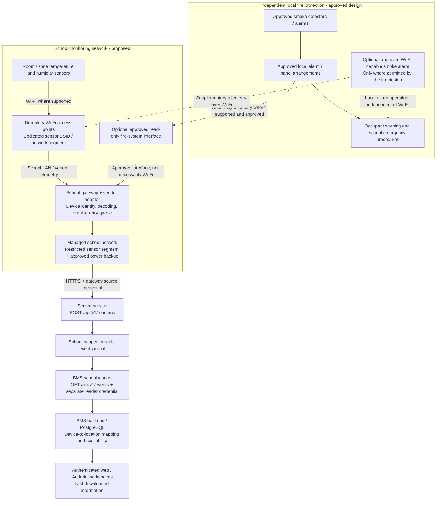

# School dormitory sensor architecture

**Status:** Proposed deployment design, not an installed or certified system.
**Scope:** Smoke detection, room temperature and relative humidity.
**Audience:** School leadership, facilities staff, installers and BMS developers.

**Deployment readiness:** This document does not authorise a physical pilot.
The deployment gates below require recorded decisions and acceptance evidence;
documentation, synthetic sender tests and a configured timeout do not close them.

## 1. What the school is setting up

Each monitored room or area has identifiable sensors. Their observations travel
through a school gateway/adapter to the Wallinde sensor service. The BMS backend
associates each device with its actual dormitory location, and staff review the
latest downloaded information in their authorised workspace.

There are **two separate systems**:

| System | Responsibility | Dependency on BMS |
|---|---|---|
| Approved local fire protection | Detect fire and warn occupants through the school's approved alarm and evacuation arrangements | None |
| BMS monitoring | Record supplementary observations, show device availability and support inspection/follow-up work | Requires the sensor data path |

The BMS gateway must not be required for local smoke detection or occupant
notification. BMS must not silence, reset or control fire-alarm equipment.
Connect an existing fire panel only through a manufacturer-approved, read-only
interface installed by a qualified fire-system professional.

USFA campus guidance highlights functioning smoke alarms, fire-alarm systems,
escape routes and sprinklers [1]. It is background guidance, **not a substitute
for the school's applicable building/fire rules**. Country, occupancy
classification, building plans and the responsible local authority must be
confirmed before selecting or installing life-safety equipment. Do not treat
ordinary IoT smoke sensors or temperature thresholds as an approved fire system.

### Deployment decision register

| Gate | Decision needed / current position | Accountable owner | Evidence required to close |
|---|---|---|---|
| D01 - Hardware and adapter | Device models, approved smoke interface, supported firmware and telemetry protocol remain unselected | Fire-system professional and integration maintainer | Local suitability approval, vendor interface specification and a real-device alarm/clear/test/environmental decoding test |
| D02 - Freshness policy | A 300-second software default exists; per-device-class reporting and timeout policies are not approved | Integration maintainer and school operations | Measured reporting, sleep, jitter and reconnect behaviour; configured timeouts; deliberate missed-report and stale-measurement tests |
| D03 - Outage and history retention | Device buffering, adapter queue capacity, overflow handling and recovery remain deployment blockers | Integration maintainer and school operations | Approved outage duration/loss policy, implemented durable queue, capacity calculation and failure/recovery tests with actual devices |
| D04 - Reachable secure ingress | The loopback service alone is not a school-network deployment | School IT / hosting operator | Approved DNS/TLS ingress, firewall/credential controls, successful adapter POST and school-worker feed read from the intended networks |
| D05 - Staff notification boundary | MVP is deliberately in-app-only and supplementary; it provides no proactive BMS alarm delivery | School leadership and duty operations | Written acknowledgement of the limitation and independently operational local alarm/emergency arrangements |

**Decision order:** Select and bench-test the hardware/interface first, measure
its reporting and outage behaviour, then approve freshness and queue policies.
Build/test the adapter and HTTPS path before commissioning the dormitory pilot.
School acknowledgement of the notification boundary is required before use.
Selecting a product does not by itself close D01.

## 2. Architecture diagram



The read-only panel connection is optional and **not implemented** in the current
application. If a panel exposes only a zone-level alarm, map that observation to
the zone; do not invent room-level precision. Do not connect individual panel
detectors to an IoT gateway unless the manufacturer-approved design permits it.

## 3. Physical setup in each dormitory

Survey the dormitory first: rooms, floors, corridors, stairs, common areas,
electrical/service rooms, existing alarm zones, network routes and power.

| Area | Proposed monitoring arrangement | Installation constraint |
|---|---|---|
| Sleeping rooms | Temperature/humidity monitoring for each independently monitored room or environmental zone; smoke protection according to the approved fire design | Smoke device type, count, position, interconnection and coverage are determined by the qualified designer, local requirements and manufacturer |
| Corridors, stairs and common areas | Environmental monitoring where these are distinct zones; approved fire coverage as required | A corridor reading must not be presented as every bedroom's condition |
| Electrical/service rooms | Assess separately with the fire designer; add environmental telemetry only where suitable | Do not assume the same sensor type is appropriate for every hazard |
| Secure communications location | Gateway/adapter, network equipment and approved power backup | Accessible to authorised maintainers, not students; not obstructing an escape route |

For temperature/humidity, choose a representative ambient-air position following
the selected product's instructions. Avoid mounting that measures a heater,
sunlit surface, direct ventilation jet or the gateway's own heat instead of room
air. Keep sensing vents unobstructed and use an enclosure appropriate to the
environment. Sensirion's design guidance explains the effects of airflow,
enclosure design and nearby heat on these measurements [2].

**No universal detector spacing, mounting height or device quantity is prescribed
here.** These require the actual plans and selected equipment.

### Illustrative inventory, not a fire coverage plan

For a dormitory with eight separately monitored bedrooms and one distinct common
area, a starting environmental inventory could be eight combined
temperature/humidity devices plus one common-area device. Validate whether room
size, partitions or airflow require additional measurement points.

Smoke equipment quantities come from the approved fire design, not this example.
One school gateway may serve several dormitories, or several gateways may be
needed. Decide from measured network coverage, device capacity and acceptable
failure domains, not a fixed "one gateway per dormitory" rule.

## 4. Hardware and school-network selection

Do not purchase a specific model until the following are verified.

| Component | Selection/acceptance requirement |
|---|---|
| Fire equipment/interface | Appropriate local approvals and occupancy suitability; independent local operation; documented alarm, clear and fault semantics; approved telemetry interface |
| Temperature/humidity devices | Stated accuracy and operating range, stable identity, documented reporting behaviour, maintainable power supply and supported local integration |
| Gateway/adapter | Supported vendor protocol, persistent queue, authenticated uplink, clock management, recoverable configuration and observable faults |
| School network | Measured coverage at actual mounting locations, restricted access, sufficient capacity and an agreed outage plan |
| Power/backup | Documented loads, required autonomy and replacement/maintenance procedure, selected by the responsible installer |

**Proposed Wi-Fi approach:** Wi-Fi-capable monitoring devices join a dedicated
school sensor network. A local adapter collects their vendor telemetry and sends
the service's v1 observations over authenticated HTTPS. Use wired backhaul for
access points and the adapter where available. Keep students' Wi-Fi separate from
sensor administration.

Not every smoke detector has Wi-Fi. Existing panel-connected detectors remain on
their approved fire-system wiring; their optional read-only panel interface feeds
the adapter instead. Use a Wi-Fi-capable smoke alarm only where that exact product
and its local alarm arrangements are accepted by the approved fire design.

If selected devices use another radio protocol, the appropriate network and
decoder are additional components. For example, LoRaWAN is not a Wi-Fi link and
its network-server/decoder are not provided by BMS.

Design loss-of-power and loss-of-network behaviour explicitly. Size monitoring
backup power from actual loads and agreed outage duration. Backup for the fire
system belongs to the approved fire-system design, not the BMS network design.

### 4.1 Wi-Fi connection path

The proposed monitoring path is:

```text
Wi-Fi temperature/humidity device or approved Wi-Fi-capable smoke alarm
  -> dormitory access point: WALLINDE-SENSORS
  -> restricted school sensor network
  -> local vendor adapter with persistent retry queue
  -> school router/firewall
  -> HTTPS ingress for our sensor service
  -> sensor service journal
  -> school-scoped BMS worker
  -> authorised staff workspaces
```

**Wi-Fi is the network connection, not the sensor API.** A Wi-Fi association does
not automatically send readings to BMS. The selected device must expose a
documented telemetry interface, and an adapter must translate it into our v1
payload. BMS does not currently discover or configure physical Wi-Fi devices.

For a conventional fire panel, replace the first two steps with its approved
read-only interface to the adapter. Do not add Wi-Fi modules to individual
detectors on the panel circuit without manufacturer and fire-designer approval.

### 4.2 Set up the school's sensor Wi-Fi

Illustrative values below are a plan, not existing network configuration:

| Setting | Example / rule |
|---|---|
| SSID | `WALLINDE-SENSORS`; separate from student/guest networks |
| Network segment | Dedicated sensor VLAN/subnet, for example `10.42.50.0/24`, only if it does not conflict with the school's addressing |
| Access points | Managed APs with measured coverage at every mounting position; do not assume one AP covers a whole dormitory |
| Device addressing | Managed DHCP; reservations where needed for documented polling/callback configuration |
| Adapter | A maintained local host, preferably wired; illustrative address `10.42.50.10` |
| Wi-Fi security | Supported WPA2/WPA3 configuration approved by school IT; individual credentials where device/AP support permits; no open network |
| Radio compatibility | Match the selected device's supported band and security mode; enable a secured 2.4 GHz network if those devices require it |
| Network services | Approved DHCP, DNS and time synchronisation as required; no captive portal or browser-based student login |
| Firewall | Permit only required telemetry, management and uplink traffic |

Permit device-to-adapter telemetry only on the selected vendor protocol/port.
Permit adapter-to-device status reads only when the integration requires polling.
If client isolation is enabled, explicitly allow the required adapter path and
verify it works; do not enable unrestricted peer-to-peer device access.

Permit the adapter to reach the approved sensor-service ingress over TCP 443.
Allow separately documented management/update services only where necessary.
Block unsolicited internet-to-device access and unnecessary device internet
access. Do not port-forward smoke alarms or expose device management publicly.
The BMS worker needs its own HTTPS route to the service feed; phones and browsers
must not hold the gateway source credential.

Select authenticated, encrypted telemetry where the device supports it. If a
candidate only supports unauthenticated/unencrypted local telemetry, document
that limitation and obtain explicit security approval or select different
hardware; an isolated SSID alone does not establish trustworthy device identity.

### 4.3 Provision each device

1. Record the serial number, stable vendor identity, intended room/zone and
   supported telemetry capabilities before installation.
2. Use the manufacturer's authorised setup method to join `WALLINDE-SENSORS`.
   Do not assume every device uses a temporary setup hotspot or the same app.
3. Replace default administration credentials and secure or disable the setup
   interface where the manufacturer supports it. Keep Wi-Fi credentials private.
4. Verify association, addressing, signal/coverage and reconnection at the actual
   mounting position using the vendor's requirements.
5. Configure the approved local telemetry destination or read-only status
   interface. Devices send vendor events to the **adapter**, not arbitrary JSON
   directly to our ingestion endpoint.
6. Bind the stable vendor identity to the registered `externalDeviceId`. An IP
   address or MAC address alone is not sufficient proof of an authorised sender.
7. Register the allowed external device IDs under the adapter's source credential
   and create their matching SERVICE location records in BMS.
8. Perform controlled observation, alarm/clear where applicable, restart and
   reconnection tests before accepting the device.

Keep the gateway source bearer token on the adapter, not copied to every device.
Authenticate/validate device-origin telemetry using the selected vendor's
supported mechanism and the approved network controls.

### 4.4 How device telemetry reaches our service

The preferred initial integration is a **local adapter**:

| Stage | Responsibility |
|---|---|
| Device | Report a real observation or supported event through its documented interface |
| Access point / LAN | Transport packets; it does not decode smoke or environmental data |
| Vendor adapter | Validate the sender, decode units/state/time, map the device, assign/preserve an event UUID and durably queue the v1 observation |
| HTTPS ingress | Terminate approved TLS, enforce network/request controls and forward to the sensor service |
| Sensor service | Authenticate the source, check the device allowlist and schema, journal the reading and return a receipt |
| School BMS worker | Read the feed with a separate reader credential and update the mapped sensor |

The following address is an illustrative deployment placeholder, **not a
running endpoint**:

```http
POST https://sensors.school.example/api/v1/readings
Authorization: Bearer <gateway-source-token>
Content-Type: application/json
```

Use the v1 JSON in section 6 as the request body. On receipt, the service returns
`sequence`, `receivedAt` and `duplicate`. The adapter marks delivery complete only
after a successful service receipt. Lost acknowledgements are retried with the
same event ID and identical body. Surface authentication/schema/conflict failures
for intervention; do not silently discard observations or retry invalid data as
new events.

For an illustrative smoke observation, a registered smoke source submits:

```json
{
  "schemaVersion": 1,
  "eventId": "57d24b31-41af-4f5f-9bac-39b8d14c87ea",
  "deviceId": "cedar-room01-smoke-01",
  "observedAt": "2026-11-25T10:01:00Z",
  "health": "healthy",
  "measurements": {
    "smokeAlarm": true
  }
}
```

`health: healthy` and an active smoke alarm are different dimensions: fresh
telemetry does not mean there is no alarm. An unrelated heartbeat must not supply
a fabricated clear.

As an **API illustration, not a hardware recommendation**, Shelly's documented
Smoke component exposes `alarm` and `mute` separately, with `smoke.alarm`,
`smoke.alarm_off` and `smoke.alarm_test` events [4]. An adapter for that documented
interface must distinguish alarm/clear from test and must not treat `mute` as an
alarm clear. BMS must not call alarm-control methods. Actual model capability,
local approvals, firmware and delivery/authentication behaviour still require
verification. The manufacturer's WiFi component documentation illustrates
device-specific network configuration and status APIs [5].

A device that can only publish to a vendor cloud needs a separately approved,
documented cloud integration. Do not assume it can deliver local webhooks.
Direct device-to-service delivery is an alternative only if the device meets
our full JSON, identity, credential, TLS, timestamp and retry requirements; it
is not the default architecture.

### 4.5 Expose the sensor service safely

The current service binds to `127.0.0.1:8010`. This is a loopback address on the
service host, **not an address that dormitory devices can reach**. On a device,
`127.0.0.1` refers to that device itself.

Deploy an approved HTTPS reverse proxy/ingress in front of the service, with a
valid certificate and the school's approved DNS name. For a same-host proxy,
forward the authorised requests to the loopback service. If the proxy and
service are on different hosts or containers, explicitly design and protect
that internal connection; loopback forwarding across hosts will not work.

The service may be hosted on school infrastructure or an approved remote host.
The local adapter uses the ingress URL in either case. Neither DNS/proxy/TLS
deployment nor the physical Wi-Fi adapter is created by the current demo.

### 4.6 What happens when Wi-Fi fails

| Failure | Required monitoring behaviour |
|---|---|
| Device loses Wi-Fi | Detect missed expected telemetry; BMS becomes unavailable/stale under its configured policy |
| Adapter can reach devices but not the service | Queue acquired observations locally; retain original event IDs/times and retry when the uplink recovers |
| Adapter/AP loses power | Report the monitoring outage when observable; no claim that devices are reporting normally |
| Service or worker is unavailable | Retain recoverable journal/queue state and expose stale monitoring rather than a fresh normal status |

The adapter cannot recover an event it never received. Verify whether each device
buffers/replays events across Wi-Fi outages; document any event-loss limitation
and the agreed recovery procedure. Periodic status reads cannot reconstruct
every transient alarm that occurred while disconnected.

In every case, the approved local fire warning and emergency arrangements remain
independent. A Wi-Fi reconnection or replay is not proof of current safety.

## 5. Naming, registration and location mapping

Maintain an installation register with:

| Field | Illustrative value |
|---|---|
| School code | `SCHOOL-A` |
| BMS dormitory / zone / location | Cedar House / Ground floor / Room 01 |
| Gateway ID | `cedar-gw-01` |
| External device ID | `cedar-room01-th-01` |
| Purpose | Room temperature and relative humidity |
| Asset details | Manufacturer, model, serial number and firmware |
| Installation/maintenance | Position, commissioning date, responsible person, battery/service schedule |
| Data policy | Reporting interval, freshness timeout and available measurements |

The gateway ID identifies the credentialed data source; it need not correspond
one-to-one to a physical radio gateway. For a panel, each documented detector or
zone may be a logical external device beneath the panel adapter's gateway ID.

Provision **two distinct credential types** in the sensor service:

1. A gateway source credential with the school code, gateway ID, allowed device
   IDs and `mode`. Use `test` for test-only sources; `hardware` is a source label,
   not certification or proof of a correct installation.
2. A school reader credential used only by that school's BMS worker.

In BMS, an administrator registers a **SERVICE** sensor using the matching
`gatewayId`, `externalDeviceId`, location and `staleAfterSeconds`. Register each
device in both places: source allowlisting alone does not map it into BMS.
Unmapped events do not create a usable location record automatically.

School identity is derived from the source credential, not accepted as an
arbitrary school field in the device observation. Keep credentials in protected
configuration, not in frontend code, device labels or this register.

## 6. Data flow and event meaning

The vendor adapter must validate the device identity, decode its documented
payload and submit the sensor service's v1 format. It must preserve the
observation time, measurement units and event identity.

Illustrative environmental observation:

```json
{
  "schemaVersion": 1,
  "eventId": "82538c39-135c-4b62-83d6-afc4ce02af6a",
  "deviceId": "cedar-room01-th-01",
  "observedAt": "2026-11-25T10:00:00Z",
  "health": "healthy",
  "measurements": {
    "temperatureC": 24.2,
    "humidityPercent": 52.0,
    "batteryPercent": 86.0
  }
}
```

Send it to `POST /api/v1/readings` with the gateway source bearer credential over
the approved HTTPS ingress. The timestamp above is an example, not a value to
reuse; generate a new UUID per new observation.

For supported smoke telemetry, use a separate mapped device and the documented
`smokeAlarm` boolean. Do not send `smokeAlarm: false` from an unrelated
temperature/humidity device.

| Observation | Required interpretation |
|---|---|
| `smokeAlarm: true` | The source explicitly reports an alarm; retain it independently of device availability |
| `smokeAlarm: false` | A later explicit source observation clears that alarm; this does not authorise re-entry or close a finding |
| Missing `smokeAlarm` | No update to the stored smoke state; never infer a clear |
| `health: healthy` | Fresh source-reported health, not a guarantee that the building is safe |
| `health: fault/offline/unknown` or stale data | Monitoring is unavailable/degraded; never present the last normal observation as current |
| Device self-test | Keep separate from real alarm semantics using a documented adapter/test procedure |
| Temperature/humidity | Environmental measurements, not fire-detection thresholds |

The current v1 payload has no dedicated self-test event field. Do not invent an
extra field or silently turn a manufacturer's test event into a real alarm.
Use isolated test sources where appropriate; richer test metadata requires a
deliberate contract change before production integration.

## 7. Reporting, outages and follow-up

### Current software semantics versus deployment policy

The backend's `SensorServiceCreate` currently defaults `staleAfterSeconds` to
**300 seconds**, permits 15 through 604800 seconds and stores it per sensor.
The worker's configured default polling interval is **15 seconds**. These are
software settings, not values validated for an installed device class.

The present BMS availability states are **working**, **faulty** and **unknown**,
not a new three-state "healthy/degraded/offline" policy:

| Input / condition | Current BMS interpretation |
|---|---|
| Fresh observations/feed and source `health: healthy` | `working`, reason `fresh` |
| Fresh source `health: fault` or `offline` | `faulty`, with the corresponding device reason |
| Never received, stale observations/receipts/feed, service failure or invalid clock | `unknown`, with an explicit reason |
| Fresh source `health: unknown` | `unknown`, reason `device_unknown` |

`healthy`, `fault`, `offline` and `unknown` are source-reported device-health
values. Missing telemetry does not prove the device itself is offline.
Do not add a "degraded" state in documentation as if the backend implements it.
Any additional state model needs a separate contract/UI decision.

The implementation checks observation time, receipt time and successful feed
freshness. Individual measurements also retain their timestamps: a new heartbeat
does not establish that every stored measurement or retained alarm is new.
Inspect measurement age as well as overall device availability.

### Required device-class policy

Agree a reporting/heartbeat policy **per device type**. Battery-powered devices
may not provide the same reporting cadence as mains-powered devices. Confirm
the vendor behaviour before setting a freshness timeout.

| Device class | Reporting input to verify | Policy status |
|---|---|---|
| Mains-powered temperature/humidity device | Measurement interval, heartbeat, allowed jitter and reconnect delay | Not approved until measured on selected hardware |
| Battery temperature/humidity device | Sleep/wake schedule, change-driven versus periodic readings and battery trade-off | Not approved until measured on selected hardware |
| Battery Wi-Fi smoke alarm | Documented supervision/heartbeat, wake events, missed-report detectability and alarm delivery during disconnection | Not approved; quiet periods must not be interpreted as healthy operation |
| Read-only fire-panel interface | Panel/interface supervision, polling/event delivery and distinction between panel health and detector/zone health | Not approved until the selected interface is tested |

For each installed device, record the expected maximum reporting interval,
allowed jitter/reconnect delay, chosen `staleAfterSeconds`, available measurement
ages and responsible maintainer. A device with no usable supervision signal
cannot obtain continuous availability assurance by choosing a very long timeout;
reject it for that requirement or document and approve the reduced assurance.

For planning only, a device supporting a genuine 60-second heartbeat might use a
180-second BMS freshness timeout after load and failure testing. This is not a
fire-alarm response requirement, a battery-life promise or a default for every
device. Assess observation, receipt, worker polling and staff refresh delays
together.

### Required outage and queue policy

Before implementation/procurement is accepted, record:

| Policy input | Required decision |
|---|---|
| Device acquisition gap | Whether the selected device buffers events when Wi-Fi is lost, for how long, and what is irrecoverable |
| Supported outage | Maximum monitoring-uplink outage to retain, separately from device-to-adapter outages |
| Queue size | Maximum events and bytes, accounting for all devices, peak event bursts, actual encoded size and storage overhead |
| Capacity warnings | High-water/full thresholds and an operational notification mechanism with a named maintainer; this is not supplied by current BMS notifications |
| Overflow | Explicit loss/impairment procedure, durable gap record where possible and staff escalation; never silently discard smoke transitions |
| Recovery | Retry ordering, original event IDs/times, acknowledgement handling, throughput and acceptable drain time |
| Maintenance | Disk-full handling, power-loss recovery, queue backups where applicable and approved retention/cleanup |

Size retention from the agreed aggregate event rate multiplied by the supported
outage duration, then allow measured burst and storage overhead. Do not prescribe
an arbitrary event count without the device inventory and measured traffic.
State what happens when capacity is exceeded: no finite queue guarantees lossless
history for an unlimited outage. Routine-reading compaction, if ever introduced,
must not silently erase alarm/clear transitions or required inspection history.

The proposed adapter must queue observations durably during uplink outages,
retain the original timestamps and resend identical payloads with the same event
IDs. Changed payloads need new event IDs. Alarm and clear transitions must not be
dropped by queue compaction. Define queue limits, overflow notification and
recovery procedures before commissioning.

The existing service journal supports exact replay receipts and rejects changed
payloads using the same event ID. The backend checks observation/receipt/feed
freshness and preserves measurement timestamps. A delayed replay must not turn
an old observation into current assurance.

Current BMS unavailable-sensor handling supports daily manual-check follow-ups
and supervisor summaries. Assign an active Officer and approve the school's
manual-check programme before use. A completed manual check does not repair a
sensor or replace required fire-system impairment measures.

Staff must use the school's established emergency procedures for an actual
alarm. Do not wait for BMS polling, a phone refresh or an inspection task.

### Deliberate MVP notification boundary

**BMS does not proactively notify a person of a sensor alarm.** Current
information/notifications are in-app and depend on the user opening or refreshing
an authorised workspace and successful data delivery.

This is a deliberate supplementary-monitoring limitation, not a promise of
future automatic incident creation, SMS, push, calls or emergency dispatch.
School duty arrangements must not depend on someone watching the BMS screen.
Any proactive BMS delivery channel is a separate implementation and approval
decision, including recipients, delivery failures, acknowledgement, escalation
and tests. It would still not replace approved local fire protection.

Record school acknowledgement of this boundary and of any accepted sensor-history
loss limitations before allowing operational use.

## 8. Security and operating responsibilities

NIST's IoT baseline provides a useful procurement framework: device identity,
controlled configuration, data protection, restricted interfaces, authorised
software updates and cybersecurity state awareness [3]. Apply these to the
selected equipment and its support lifecycle.

Proposed deployment controls include restricted sensor-network access, unique
source credentials, HTTPS certificate verification, protected configuration and
queues, credential rotation/revocation, supported firmware and visible monitoring
failures. Do not collect student identities, audio or video for this sensor scope.

| Owner | Responsibility |
|---|---|
| School leadership | Approve scope, emergency procedures, funding and accountable duty cover |
| Qualified fire-system professional | Approved fire design, installation, testing and impairment arrangements |
| School IT / integration maintainer | Network, adapter, credentials, clock, queue, backups and service monitoring |
| BMS administrator | School/location mappings, access, Officer assignments and approved programmes |
| Officers / supervisors | Inspect according to approved procedures, review unavailable monitoring and follow up findings |
| Facilities maintainer | Inspect equipment, replace/service components according to manufacturer and local requirements |

Record service visits, device replacements, configuration changes and ownership.
When replacing a device, revoke obsolete access and explicitly update its
mapping; do not silently reuse an old identity for a different physical location.

## 9. Installation and commissioning checklist

### Before procurement

- [ ] Confirm country, applicable authority, school occupancy and building plans.
- [ ] Survey rooms, existing fire protection, alarm zones, power and network.
- [ ] Obtain the qualified fire designer's approved equipment and coverage plan.
- [ ] Select documented telemetry interfaces and environmental measurement points.
- [ ] Agree maintenance, privacy/hosting, network outage and impairment procedures.
- [ ] Define measurable delivery, freshness, queue-capacity and recovery criteria.

### Install and register

- [ ] Install fire equipment/interfaces through the qualified professional.
- [ ] Mount environmental devices according to selected manufacturer instructions.
- [ ] Install and measure network coverage at every actual sensor position.
- [ ] Configure the sensor SSID/VLAN, supported Wi-Fi security, DHCP and firewall.
- [ ] Verify device-to-adapter telemetry, including any client-isolation exception.
- [ ] Install gateway/adapter and approved monitoring power backup securely.
- [ ] Deploy approved DNS/TLS ingress and verify adapter-to-service delivery.
- [ ] Label assets and record their exact dormitory/zone/location mapping.
- [ ] Provision separate source/reader credentials; register devices as SERVICE sensors.
- [ ] Assign responsible Officers and approve unavailable-sensor check programmes.

### Demonstrate normal and failure behaviour

- [ ] Confirm each physical device appears at the correct BMS location and school.
- [ ] Compare environmental readings with a suitable reference instrument.
- [ ] Have the fire professional conduct approved alarm/interface tests and confirm
      local occupant notification independently of BMS.
- [ ] Verify source alarm, explicit clear and self-test semantics without generating
      unintended real alarms or dispatches.
- [ ] Disconnect only the monitoring uplink in a controlled test: BMS becomes stale/
      unavailable; independent fire protection remains operational.
- [ ] Restart the adapter and recover queued events with original IDs/timestamps;
      verify no silent losses, duplicate effects or false "current" readings.
- [ ] Disconnect/reconnect device Wi-Fi and restart an AP; verify the documented
      device buffering limitations, unavailable status and recovery.
- [ ] Verify smoke alarm/clear versus self-test decoding and confirm that BMS
      cannot mute/reset the local fire system.
- [ ] Exercise approved monitoring-power failure, low-battery/fault reporting,
      gateway outage, service outage, worker outage and clock-error cases.
- [ ] Verify unknown devices and wrong-school credentials cannot inject/read records.
- [ ] Verify an unavailable sensor produces the correct manual follow-up, and
      restoration does not erase completed inspection history.
- [ ] Demonstrate credential revocation, supported updates and journal/queue recovery.
- [ ] Record acceptance evidence, unresolved issues and school/installer sign-off.

Start with a limited, supervised monitoring pilot; extend dormitory by dormitory
only after acceptance. A pilot is supplementary and does not justify removing or
disabling existing approved fire protection.

## 10. What exists versus what must be built

| Capability | Current position |
|---|---|
| Versioned HTTP ingress, gateway/device allowlist and separate school reader | Implemented in `wallinde_sensor\service.py` and `contract.py` |
| Durable SQLite journal, event replay and school-scoped feed | Implemented |
| Backend SERVICE mapping, conservative freshness and stored alarm state | Implemented in the backend |
| Unavailable-sensor daily follow-up workflow | Implemented in the backend; school approval of procedures still required |
| Local sender | TEST-only; not a hardware adapter |
| Physical sensors, approved fire-panel interface and vendor decoder | Not supplied or implemented |
| Sensor SSID/VLAN, access-point provisioning and Wi-Fi device setup | Proposed deployment work; not provided by BMS |
| Gateway persistent offline queue and field network | Proposed; not implemented by the sensor service |
| Production HTTPS ingress, monitoring, backup/recovery operations | Deployment work; service currently binds to loopback |
| Temperature/humidity threshold rules and trend reporting | Not provided by the current ingestion/availability workflow |
| Alarm-triggered automatic incident creation, emergency dispatch, SMS or push | Not provided; current notifications are in-app |

**Next design inputs:** school country, dormitory/floor/room plans, existing fire
panel make/model, network/power survey, required environmental accuracy and
operations budget. These determine the final bill of materials and installation
drawings; this document does not select hardware or certify the school.

## References

References are background and procurement guidance, not local design approval.

1. U.S. Fire Administration, *Fire Safe College Housing*:
   https://www.usfa.fema.gov/downloads/pdf/publications/campus_fire_safety_flyer.pdf
2. Sensirion, *Design Guide for Humidity and Temperature Sensors*:
   https://sensirion.com/en/media/documents/FC5BED84/662B494D/Sensirion_Humidity_Temperature_Design_Guide.pdf
3. NIST, *IoT Device Cybersecurity Capability Core Baseline (NISTIR 8259A)*:
   https://csrc.nist.gov/pubs/ir/8259/a/final
4. Shelly, *Smoke component API* (vendor-specific example, not product approval):
   https://shelly-api-docs.shelly.cloud/gen2/ComponentsAndServices/Smoke/
5. Shelly, *WiFi component API* (verify support on the selected device):
   https://shelly-api-docs.shelly.cloud/gen2/ComponentsAndServices/WiFi/
